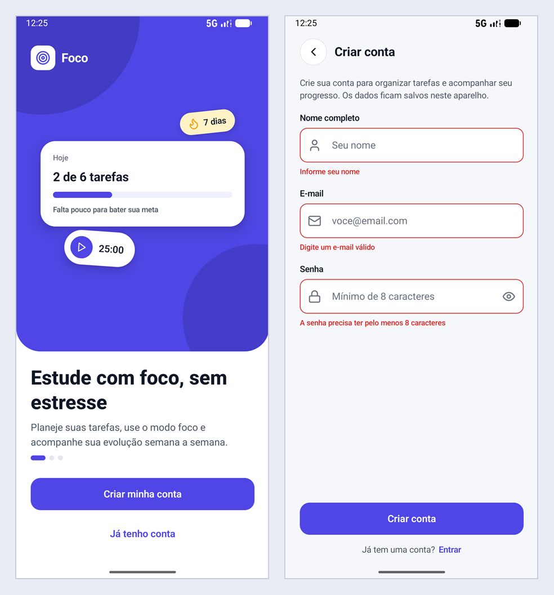
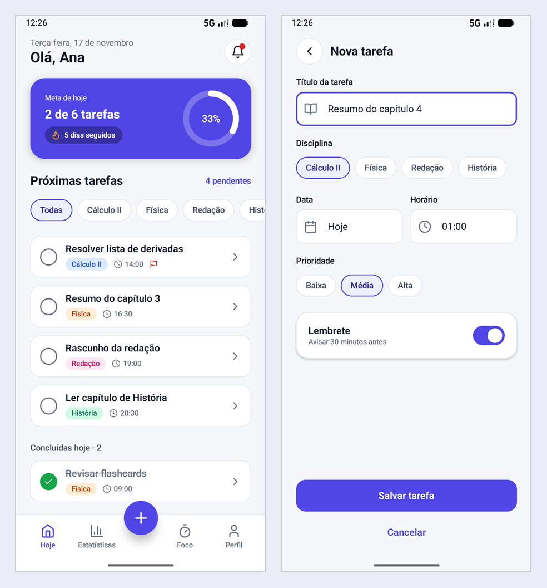
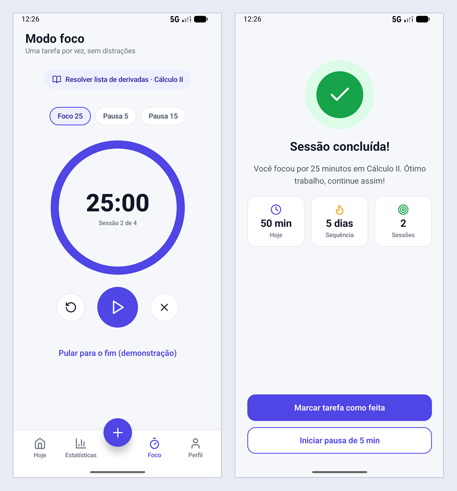
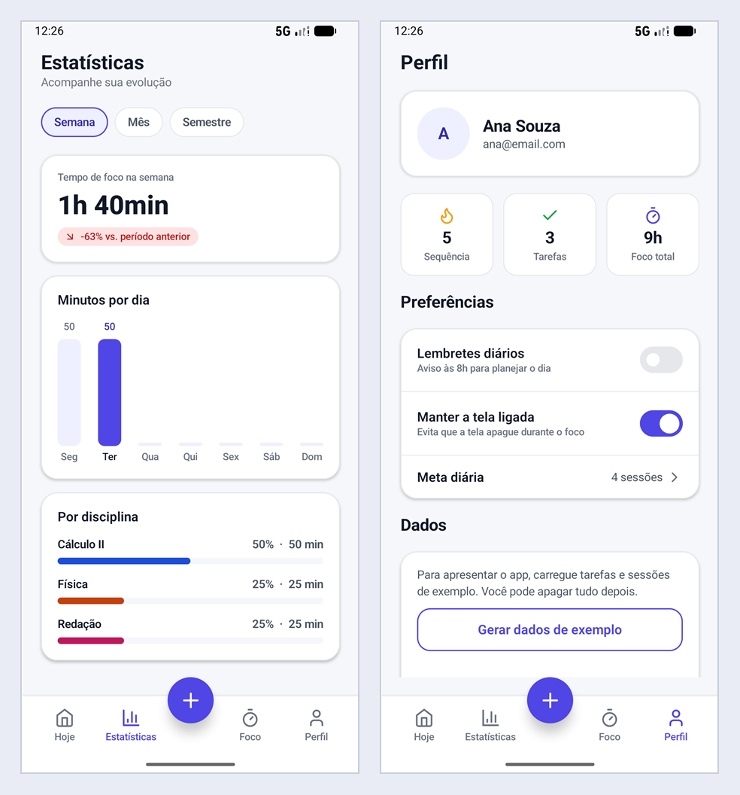

# Foco — app de planejamento de estudos (Android)

App Android feito em **Kotlin + Jetpack Compose**, baseado no protótipo de UI criado no Figma.
Ajuda estudantes a organizarem a rotina de estudos: lista de tarefas por disciplina, modo foco
(timer Pomodoro) e estatísticas de progresso.

## Telas









## Como abrir e rodar

1. Abra o **Android Studio** e escolha **File ▸ Open**, selecionando esta pasta (`FocoApp`).
2. Espere o *Gradle Sync* terminar (na primeira vez ele baixa as dependências; precisa de internet).
3. Escolha um emulador (ex.: *Medium Phone*) ou um celular com depuração USB e clique em **Run ▸ Run 'app'**.

Requisitos: Android Studio recente, JDK 17 ou superior (o Studio já traz um) e Android SDK 37 instalado.
O app roda em Android 8.0 (API 26) ou superior.

Para gerar o APK pela linha de comando:

```
./gradlew assembleDebug        # no Windows: gradlew.bat assembleDebug
```

O arquivo sai em `app/build/outputs/apk/debug/app-debug.apk`.

> No Windows, mantenha o projeto numa pasta **sem acentos** e **fora do OneDrive** (por exemplo `C:\dev\FocoApp`):
> o Android Gradle Plugin recusa caminhos com acento e a sincronização trava os arquivos de build.

## Testes

Todos os testes (lógica e telas) rodam na JVM, **sem emulador**:

```
./gradlew :app:testDebugUnitTest        # no Windows: gradlew.bat :app:testDebugUnitTest
```

No Android Studio, clique com o botão direito em `app/src/test` e escolha **Run Tests**.
O relatório em HTML fica em `app/build/reports/tests/testDebugUnitTest/index.html`.

| Arquivo | O que cobre |
|---|---|
| `timer/TimerStateTest` | Lógica do timer: iniciar, pausar, retomar, arredondamento do tempo restante, fim da contagem |
| `data/StatsTest` | Sequência de dias e estatísticas de semana, mês e semestre (virada de mês, semana começando na segunda) |
| `data/FmtTest` | Formatação de horários, durações e datas em português |
| `data/DefaultDueTest` | Data e horário sugeridos na nova tarefa (depois das 22h, amanhã às 9h) |
| `AppViewModelTest` | Conta e login, tarefas, timer completo (com relógio falso), pausas, alarme e timer salvo, dados de exemplo |
| `FocoFlowTest` | Testes de tela: cadastro com validação, login, criar e concluir tarefa, sessão de foco do início ao fim, estatísticas |

O `AppViewModel` recebe o armazenamento, os lembretes, o alarme e o relógio pelo construtor; nos testes entram
versões falsas (`app/src/test/java/com/foco/app/testing`).

Os testes de tela (`FocoFlowTest`) usam o **Compose Test com Robolectric**, simulando um Android 15 na JVM.
Eles não usam os testes no aparelho (`androidTest`) porque o Espresso, de que o Compose Test depende,
ainda não funciona no Android 17 (as 8 telas falhavam todas com um erro interno do Espresso).
O Robolectric baixa o Android simulado na primeira execução, então ela precisa de internet.

## O que o app faz

| Tela | Funcionalidades |
|---|---|
| Onboarding | Apresentação do app |
| Cadastro / Entrar | Conta local no aparelho, com validação de nome, e-mail e senha (mínimo 8 caracteres) |
| Hoje | Saudação com data, meta do dia (anel de progresso), sequência de dias, filtro por disciplina, concluir tarefa (toque no círculo) e excluir (toque longo) |
| Nova tarefa | Título, disciplina, data e hora (seletores do Android), prioridade e lembrete |
| Modo foco | Timer de 25 / 5 / 15 min com iniciar, pausar, reiniciar e encerrar; escolha da tarefa; mantém a tela ligada |
| Sessão concluída | Resumo da sessão, sequência, marcar tarefa como feita e iniciar a pausa |
| Estatísticas | Semana / mês / semestre: total de tempo, gráfico de barras e divisão por disciplina |
| Perfil | Dados da conta, totais, preferências, dados de exemplo, apagar dados e sair |

Os dados (tarefas, sessões e perfil) ficam salvos no aparelho, em `SharedPreferences` (JSON).
Não há servidor: a "conta" existe só neste aparelho e a senha é guardada como hash SHA-256.

### Lembretes

- Ao criar uma tarefa com **Lembrete** ligado, o app agenda uma notificação 30 minutos antes.
- Em **Perfil ▸ Lembretes diários**, agenda um aviso todo dia às 8h.
- No Android 13 ou superior o app pede a permissão de notificações.
- Os alarmes não são reagendados depois de reiniciar o aparelho (limitação desta versão).

### Timer em segundo plano

O timer não conta segundo a segundo: ele guarda **o horário em que termina** (`TimerState`, salvo a cada mudança).

- Ao iniciar, o app agenda um **alarme exato** do sistema para esse horário (`AndroidTimerAlarm`).
- Com o app em segundo plano ou até encerrado pelo Android, o alarme acorda o app e mostra a notificação
  "Sessão de foco concluída" (ou "Pausa terminou"). Com o app na tela, não há notificação.
- Ao abrir o app, o `AppViewModel` lê o timer salvo: se ainda está rodando, continua de onde estava; se já terminou,
  registra a sessão **no horário em que acabou** e abre a tela "Sessão concluída".
- Quem registra as sessões é sempre o `AppViewModel` (nunca o alarme), para nunca duplicar.

### Para apresentar

- **Perfil ▸ Gerar dados de exemplo** cria tarefas e duas semanas de sessões, para as telas ficarem completas.
- No modo foco, **Pular para o fim (demonstração)** conclui a sessão na hora, sem esperar 25 minutos.
  Esse botão é só para demonstração e registra a sessão com a duração cheia.

## Estrutura do projeto

```
app/src/main/java/com/foco/app/
├── MainActivity.kt          entrada do app (tema + navegação)
├── AppViewModel.kt          estado do app: tarefas, sessões, perfil e timer
├── data/                    modelos, armazenamento local (FocoStore) e cálculos (Stats, Fmt)
├── timer/                   lógica do timer (TimerState, relógio e a interface do alarme)
├── notifications/           lembretes e alarme do timer (AlarmManager + notificação)
└── ui/
    ├── Theme.kt             cores e estilos de texto (tokens do design system)
    ├── Components.kt        botões, campos, chips, cartão de tarefa, barra de abas, gráficos
    ├── FocoApp.kt           rotas e barra de navegação
    └── screens/             uma tela por arquivo (ou grupo de telas)
app/src/main/res/drawable/   ícones (VectorDrawable, conjunto Lucide)
```

## Design

As cores, os espaçamentos e os estilos de texto seguem o design system do protótipo no Figma
(`ui/Theme.kt`). A fonte do protótipo é a **Plus Jakarta Sans**; nesta versão o app usa a fonte
padrão do sistema. Para usar a mesma fonte do Figma:

1. Baixe a *Plus Jakarta Sans* (Google Fonts, licença OFL) e coloque o arquivo em `app/src/main/res/font/`
   com um nome em minúsculas, por exemplo `plus_jakarta_sans.ttf`.
2. Em `ui/Theme.kt`, troque o valor de `Family` por `FontFamily(Font(R.font.plus_jakarta_sans))`.

## Limitações conhecidas

- Só português (textos escritos direto no código).
- Sem sincronização na nuvem e sem recuperação de senha.
- O alarme do timer e os lembretes não são reagendados sozinhos depois de reiniciar o aparelho (o timer, porém,
  é concluído ao reabrir o app, pois o horário de término fica salvo).
- O alarme exato usa a permissão `USE_EXACT_ALARM`, própria de apps de timer e despertador; a Google Play
  exige justificar esse uso na publicação.
- Interface pensada para celular em modo retrato.
